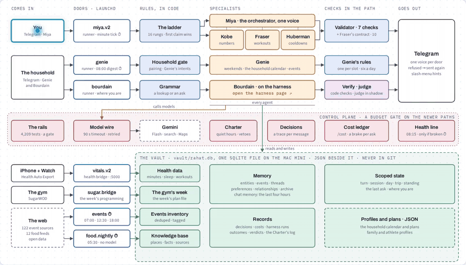
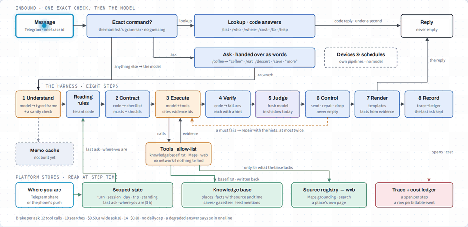

<div align="center">

# 🪶 Rahat

### The platform under Miya, my personal AI agent

*Miya is the one I talk to. Rahat is everything underneath: specialist agents that prove themselves on their own front door before they join Miya, checks in the path, a harness every answer runs through, and a record of every decision. Built at human scale.*

<a href="https://modernthinkerbuilds.github.io/Rahat-Plane/specs/RAHAT-ARCHITECTURE.html"></a>

<sub>A <code>/week</code> message moving through Rahat, from Telegram through the routing ladder to Kobe. Click it for the live page, then tap any box.</sub>

| [**See it move →**](https://modernthinkerbuilds.github.io/Rahat-Plane/specs/RAHAT-ARCHITECTURE.html) | [**Inside one agent →**](https://modernthinkerbuilds.github.io/Rahat-Plane/specs/ADR-018.html) | [**How it's built →**](./specs/ARCHITECTURE.md) |
|:---:|:---:|:---:|
| The whole system on one page. Tap any box, or watch a message travel. | The harness every answer runs through (ADR-018), step by step. | The as-built architecture, the decision records and the tests. |

</div>

---

An agent can be fluent and wrong at the same time, and you can't tell from reading it. Run several and they contradict each other, act when they shouldn't, and remember the wrong things. That isn't a model problem. It's the layer underneath, which is what this repo is.

> **Miya is my personal AI agent. Rahat is the platform it runs on, built and run at home: specialists that share one memory, one rulebook and one record of every decision. It runs in my life every day.**

`3` front doors · `6` agents · `8` services (5 always on) · `121` event sources · `1` SQLite file of record · `4,209` tests

<sub>Counts as of Oct 14–17, 2026.</sub>

---

## How a message flows

```
 you, on Telegram
        │
┌───────▼──────────────────────┐
│ a front door                 │   Miya for me; Genie and
│ Miya · Genie · Bourdain      │   Bourdain on their own doors
└───────┬──────────────────────┘   for the household
        │
┌───────▼──────────────────────┐
│ a ladder of rules, in code   │   commands, logs and known asks
│ first rule to claim it wins  │   are answered without a model
└───────┬──────────────────────┘
        │
┌───────▼──────────────────────┐   ┌──────────────────────────┐
│ the specialist does the work │◄─►│ the Charter              │
│ model + tools + the day's    │   │ may this act now? quiet  │
│ facts                        │   │ hours, recovery, vetoes; │
└───────┬──────────────────────┘   │ every verdict logged     │
        │                          └──────────────────────────┘
        │
┌───────▼──────────────────────┐
│ checks in the path           │   code checks the answer against
│ contract · validator · judge │   what is true; one repair; if it
└───────┬──────────────────────┘   still fails, the reply says so
        │
        ▼
   one voice back to you
        │
┌───────▼──────────────────────┐
│ one SQLite file, on the Mac  │   memory · decisions · outcomes ·
│ the record of all of it      │   knowledge with sources · costs
└──────────────────────────────┘
```

---

## The agents

| Agent | Owns | Status |
|---|---|---|
| **Miya** (orchestrator) | My personal agent, the one I talk to. A 16-rung routing ladder in code, delegation, reconciliation, one voice out. [`core/miya.py`](./core/miya.py) | Live |
| **Kobe** | The week's numbers, computed in code. [`agents/the_scientist/`](./agents/the_scientist/) | Live, behind Miya |
| **Fraser** | Workout design, checked against a 10-point contract in code before it's sent. [`agents/fraser/`](./agents/fraser/) | Live, behind Miya |
| **Huberman** | The 9:30 pm cooldown: reads the day's workout and recovery and picks from a 25-drill library, with rotation. [`agents/huberman/`](./agents/huberman/) | Live, behind Miya |
| **Genie** | Weekends, a household calendar that schedules rather than lists, and a digest of local events. [`agents/genie/`](./agents/genie/) | Live, behind Miya, with its own bot for the household; my wife uses it too, from her own phone |
| **Bourdain** | "Where do we eat?" Answers from what it already knows, your saved places first, and searches live when that comes up short; every answer runs the harness (below). [`agents/bourdain/`](./agents/bourdain/) | Live on its own bot since Sep 20; on the harness since Oct 4; joins Miya when it passes |

**How an agent joins.** Each one starts on its own front door, with its own bot and its own tests, where its failures are easy to see and can't break anything else. When it passes, it's wired in behind Miya ([`agent_boot.py`](./new_plane/miya_runner/agent_boot.py)), and Miya stays the one place I ask. Genie came in that way, and it took a weekend. Bourdain is next.

**Orchestration, honestly.** Today the routing ladder answers the asks it recognizes without a model, and anything it doesn't claim goes to Miya's model, which draws on the specialists and answers in one voice; when two specialists disagree it reconciles them, best-effort. Where it's going: each agent declares what it does in a manifest, and a model reads every ask and hands it to the right agent, with the code rules still in front. *Not built yet.*

---

## The harness ([ADR-018](./specs/ADR-018-outcome-contracts-and-independent-evaluation.md))

<a href="https://modernthinkerbuilds.github.io/Rahat-Plane/specs/ADR-018.html"></a>

<sub>An ask going through the harness. Click it for the live page.</sub>

One loop an agent's answer runs through, owned by the platform, not by the agent. An agent joins with a manifest, an outcome library, a checklist and its tools ([`agents/bourdain/`](./agents/bourdain/): 51 outcomes, 3 of them mandatory).

```
 an ask
   │
   ▼
 1 UNDERSTAND  a model reads the ask into a frame: who is eating,
   │           where, when, what kind of answer; no regex on free text
   ▼
 2 CONTRACT    the outcomes this answer must meet: musts from the
   │           outcome library (51 outcomes) and the party's own rules
   ▼
 3 EXECUTE     the model with allow-listed tools: Google Maps places,
   │           the knowledge base, fetch a page; a per-ask brake
   ▼
 4 VERIFY      code checks every must against the evidence: open at
   │           that hour? within the drive? fits everyone's diet?
   ▼
 5 JUDGE       a second model grades what code can't (taste, fit);
   │           in shadow until it agrees with me (below)
   ▼
 6 CONTROL     pass → render; fail → one repair with the findings;
   │           still failing → drop that pick, or say plainly why
   ▼
 7 RENDER      one reply; sources named; nothing the evidence lacks
   │
   ▼
 8 RECORD      the run, each outcome, the verdicts, the cost; every
               model and tool call keyed by request, so it replays

 The judge earns its vote, outcome by outcome
 ┌──────────┬──────────────────────────────────────┬──────────────┐
 │ shadow   │ under 50 labels, or under 80% agreed │ today: all   │
 │ annotate │ 80%+ agreement on 50+ labels         │ shadow, with │
 │ block    │ 90%+ on one outcome, 10+ labels      │ 3 labels     │
 └──────────┴──────────────────────────────────────┴──────────────┘
```

- **Who's on it:** one agent (Bourdain), and a second using its contract (Fraser writes its 10 outcomes into the same tables). The wider rollout is parked.
- **Knowledge with receipts:** every fact in Bourdain's knowledge base stores its source, how it was obtained, when it was read and how long it stays fresh: 326 places and 3,397 facts (Oct 14). A misread can be forgotten ([`scripts/kb_forget.py`](./scripts/kb_forget.py)).
- **Evals that replay for $0:** every model and tool call is recorded against its request, so a run replays without a network or a bill; production never reads a recording. The golden sets (72 real Bourdain asks and 14 Genie asks) stay private; the public tests run on synthetic twins. A live incident becomes a case.
- **What it's like live:** 22 harness runs between Oct 4 and 11 (19 Bourdain answers, 3 Fraser designs). One household's volume, not a benchmark. A Bourdain answer takes about a minute.
- **The judge so far:** 214 verdicts, all in shadow, with 3 labels of the 50 it needs.

---

## The platform underneath

| | What it does | Code |
|---|---|---|
| **Fact validator** | Checks Miya's replies against what's true and rewrites before send. Seven checks; the newest: a reply never claims a change that wasn't written | [`validator.py`](./new_plane/miya_runner/validator.py) |
| **Design contract** | Fraser's workouts pass 10 checks in code; one repair; if it still fails, the reply names what isn't verified | [`contract.py`](./agents/fraser/contract.py) |
| **Charter** | Quiet hours, recovery blocks, vetoes for the agents that write and nudge; every verdict logged | [`charter.py`](./core/charter.py) |
| **Decision ledger** | One row per decision: agent, rule, latency, cost. 7,408 rows since May 8 | [`decisions.py`](./core/decisions.py) |
| **Cost ledger** | Prices all four token buckets per call. A budget gate on the newer paths, plus a per-ask brake in the harness | [`ledger.py`](./core/ledger.py) · [`budget.py`](./core/budget.py) |
| **Routing ladder** | Sixteen rungs, first claim wins; deterministic routes never call the model | [`delegate_classifier.py`](./new_plane/miya_runner/delegate_classifier.py) |
| **Health line** | One line at 08:15 when something is broken; silence otherwise | [`health.py`](./core/health.py) |
| **Events** | 121 sources: 43 read in plain code with no model, 64 pages a model reads daily, 14 grounded searches twice a week. Deduped, tagged by audience | [`bridges/events/`](./bridges/events/readers.py) |
| **Food feeds** | Twelve food feeds read nightly at 05:30 in code, no model; places they name become mentions, and closures become facts | [`bridges/food/`](./bridges/food/) |
| **Gazetteer** | 21,555 Bay Area eating places from open data (© OpenStreetMap contributors), under the knowledge base; a row is promoted only when an ask or a mention touches it | [`gazetteer.py`](./core/kb/gazetteer.py) |
| **Health ingestion** | 150+ metrics at minute resolution, sleep stages, typed workouts | [`bridges/healthkit/`](./bridges/healthkit/ingest.py) |

**Governing principle ([ADR-011](./specs/ADR-011-deterministic-shell-llm-core.md)): deterministic shell, LLM core.** State, math, routing and vetoes are deterministic and tested. Intent, taste and phrasing are the model's.

**Where the data path is going:** the database answers first; code applies the facts (who is eating, how far, open now); the model applies taste, once; the internet is touched only when the database comes up short or I say "search". *That path isn't built yet.*

**Memory, honestly:** in daily use (1,621 entities and 1,694 events through Oct 12). Two of its five primitives barely run: preferences and relationships. The nightly consolidation job exists but hasn't been scheduled since May.

---

## Why the validator exists

Early on, the assistant told me a fact about me that had never been true, stated confidently in its normal voice. Nothing was checking it. Ten prompt patches later I was treating a systemic failure as bad luck, so I stopped adding features and rebuilt the core: a validator now sits between the agent and me, and the check runs on the way out, not as an instruction inside the prompt.

Replaying **126 real messages** from my own history: voice leaks **0%**, contradictions caught and corrected in **4.8%** of replies.

---

## The bet

Where the architecture points, labeled by how far each part has come.

- **Outcomes, not answers.** *Measuring shipped for one agent; learning not built.* Bourdain's answers are checked against named outcomes and recorded, and the golden set replays for $0. A loop that changes behavior from outcomes, and proves a cheaper model kept the result, is not built.
- **Memory that keeps what *mattered*.** *Not built.* Shared typed memory is table stakes (Letta, Mem0). The bet is recall conditioned on what changed an outcome, not on what was recent.
- **A receipt for every fact.** *Partial, one agent.* Bourdain's facts, including those from open data and the food feeds, carry their source and date. The profile, memory and the training numbers don't yet.

---

## Verify it yourself

```bash
RAHAT_TEST_MODE=1 python -m tests.run_all
```

```
 BEFORE A CHANGE SHIPS
 a fix ─► adds a regression pin; a fix: commit with no new pin
 │        is refused at merge
 ▼
 the pre-push gate; anything red blocks the push
 ┌─────────────────────────┬──────────────────────────────────────────┐
 │ private words           │ a name, address, token or chat id in     │
 │                         │ anything the push would publish          │
 │ bug-to-test policy      │ every fix carries its own test           │
 │ regression registry     │ 1,877 tests in 219 pins                  │
 │ silent-failure guard    │ every agent answers its canonical asks   │
 │                         │ with a real reply, never a stub          │
 │ unit · contract layers  │                                          │
 └─────────────────────────┴──────────────────────────────────────────┘
 the full suite: 4,209 tests, hermetic: no network, no live
 database, no secrets loaded (RAHAT_TEST_MODE=1)

 IN PRODUCTION
 ┌─────────────────────────┬──────────────────────────────────────────┐
 │ model calls end         │ 90 s timeout on the shared client, a     │
 │                         │ retry on a provider hiccup, "still       │
 │                         │ checking" when a Bourdain ask runs long  │
 │ messages land           │ a reply Telegram refuses for its         │
 │                         │ formatting goes again as plain text; a   │
 │                         │ missed nudge is tried the next minute    │
 │ it tells on itself      │ one line at 08:15 when something is      │
 │                         │ broken; silence when nothing is          │
 └─────────────────────────┴──────────────────────────────────────────┘
```

[`tests/quality_gate/`](./tests/quality_gate/) and [`tests/regression_registry/`](./tests/regression_registry/) are the list of ways this system has actually failed.

---

## Scope

Personal-scale, not a product. The *problems* generalize to any fleet of agents; the product doesn't. State lives in one SQLite file on a Mac mini at home; each model or maps call sends that request's context to the provider, and messages travel through Telegram.

Built by **Venkat Sadras**, a Bay Area PM at a large tech company, hands-on with multi-agent systems. Views my own, not my employer's.

Rahat runs on its own local Python runtime. An [OpenClaw](https://github.com/openclaw/openclaw) adapter is kept as one integration target, not a foundation, and is currently parked ([ADR-014](./specs/ADR-014_openclaw_position.md)).

Licensed under the [Apache License 2.0](./LICENSE).
