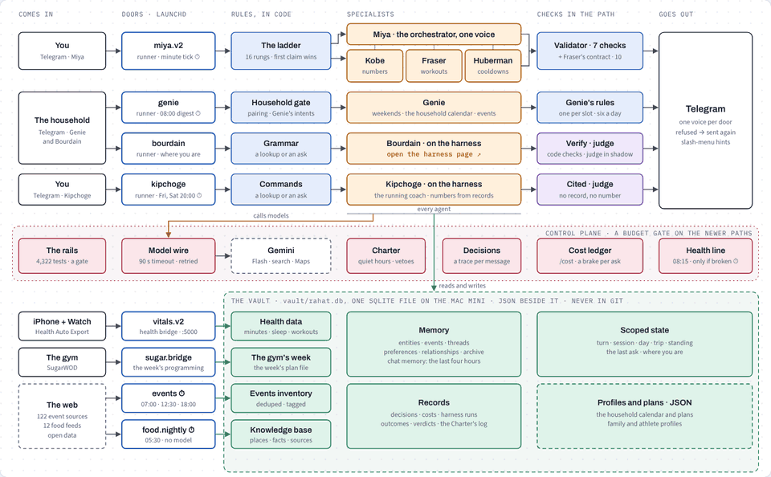
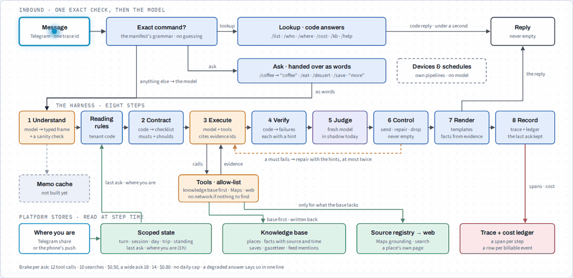

<div align="center">

# 🪶 Rahat

### An open-source AI agent platform

*Rahat is the agent platform I built; seven agents run on it. Miya is the one I talk to. One harness agents answer through, evals that replay for $0, checks in code, and a record of every decision. Built at human scale.*

<a href="https://github.com/modernthinkerbuilds/Rahat-Plane/actions/workflows/tests.yml"></a> <a href="https://github.com/modernthinkerbuilds/Rahat-Plane/actions/workflows/gates.yml"></a>

<a href="https://modernthinkerbuilds.github.io/Rahat-Plane/specs/RAHAT-ARCHITECTURE.html"></a>

<sub>A <code>/week</code> message moving through Rahat, from Telegram through the routing ladder to Kobe. Click it for the live page, then tap any box.</sub>

| [**See it move →**](https://modernthinkerbuilds.github.io/Rahat-Plane/specs/RAHAT-ARCHITECTURE.html) | [**Inside one agent →**](https://modernthinkerbuilds.github.io/Rahat-Plane/specs/ADR-018.html) | [**How it's built →**](./specs/ARCHITECTURE.md) |
|:---:|:---:|:---:|
| The whole system on one page. Tap any box, or watch a message travel. | The harness every answer runs through (ADR-018), step by step. | The as-built architecture, the decision records and the tests. |

</div>

---

An agent can be fluent and wrong at the same time, and you can't tell from reading it. Run several and they contradict each other, act when they shouldn't, and remember the wrong things. That isn't a model problem. It's the layer underneath, which is what this repo is.

> **Rahat is the agent platform I built; seven agents run on it. Miya is the one I talk to. The agents share one memory, one rulebook and one record of every decision, and they run in my life every day.**

`7` agents · `2` on the harness · `4` doors · `8` services (5 always on) · `122` event sources · `1` SQLite file of record · `4,209` tests

<sub>Agents, harness agents and doors as of Nov 1; the rest as of Oct 14–19, 2026. By [Venkat Sadras](https://venkatsadras.com) · [LinkedIn](https://www.linkedin.com/in/venkatsadras/).</sub>

---

## How a message flows

```
 you, on Telegram
        │
┌───────▼──────────────────────┐
│ a door                       │   Miya for me; Genie, Bourdain
│ Miya · Genie · Bourdain ·    │   and Kipchoge on their own
│ Kipchoge                     │   doors
└───────┬──────────────────────┘
        │
┌───────▼──────────────────────┐
│ a ladder of rules, in code   │   commands, logs and known asks
│ first rule to claim it wins  │   are answered without a model
└───────┬──────────────────────┘
        │
┌───────▼──────────────────────┐   ┌──────────────────────────┐
│ the specialist does the work │◄─►│ the Charter              │
│ model + tools + the day's    │   │ may this act now? quiet  │
│ facts                        │   │ hours, recovery, vetoes; │
└───────┬──────────────────────┘   │ every verdict logged     │
        │                          └──────────────────────────┘
        │
┌───────▼──────────────────────┐
│ checks in the path           │   code checks the answer against
│ contract · validator · judge │   what is true; one repair; if it
└───────┬──────────────────────┘   still fails, the reply says so
        │
        ▼
   one voice back to you
        │
┌───────▼──────────────────────┐
│ one SQLite file, on the Mac  │   memory · decisions · outcomes ·
│ the record of all of it      │   knowledge with sources · costs
└──────────────────────────────┘
```

---

## The agents

Miya is the one I talk to. It hands each ask to one of six specialists, in two groups: training and recovery, and family life.

| Agent | Owns | Status |
|---|---|---|
| **Miya** (orchestrator) | My personal agent, the one I talk to. A 16-rung routing ladder in code, delegation, reconciliation, one voice out. [`new_plane/miya_runner/`](./new_plane/miya_runner/) | Live |
| *Training and recovery* | | |
| **Kobe** | The week's numbers, computed in code. [`agents/the_scientist/`](./agents/the_scientist/) | Live, behind Miya |
| **Fraser** | Workout design, checked against a 10-point contract in code before it's sent. [`agents/fraser/`](./agents/fraser/) | Live, behind Miya |
| **Kipchoge** | The running coach. Every number in a message is computed in code and cited from a record; the model writes only the words, and a message with a number that has no record behind it is never sent. The second tenant on the harness. [`agents/kipchoge/`](./agents/kipchoge/) | Live on its own bot since Nov 1; through Miya soon (the route is built and switched off) |
| **Huberman** | The 9:30 pm cooldown: reads the day's workout and recovery and picks from a 25-drill library, with rotation. [`agents/huberman/`](./agents/huberman/) | Live, behind Miya |
| *Family life* | | |
| **Genie** | Weekends, a household calendar that schedules rather than lists, and a digest of local events. [`agents/genie/`](./agents/genie/) | Live, behind Miya, with its own bot for the household; my wife uses it too, from her own phone |
| **Bourdain** | "Where do we eat?" Answers from what it already knows, your saved places first, and searches live when that comes up short; every answer runs the harness (below). [`agents/bourdain/`](./agents/bourdain/) | Live on its own bot since Sep 20; on the harness since Oct 4; through Miya soon, once it passes |

**How an agent joins the platform.** A new agent brings a manifest (its tools, budgets, latency and capabilities), an outcome library (Bourdain 52, Kipchoge 19), a judge checklist (21 and 8 criteria), its own shapes (what it reads, what it answers, what counts as evidence) and its tests; the platform brings the loop, the brake, the ledger, the judge, the controller and the record. Before it serves, it passes [`test_tenant_conformance.py`](./tests/test_tenant_conformance.py) with Bourdain's 72-case snapshot unchanged, byte for byte. Kipchoge went through it: the shapes amendment (A6) was accepted Oct 25, and it went live on its own bot Nov 1.

**Doors.** Bourdain is the first agent to start on its own front door, with its own bot and its own tests, where its failures are easy to see and can't break anything else. When it passes, it's wired in behind Miya ([`agent_boot.py`](./new_plane/miya_runner/agent_boot.py)), and Miya stays the one place I ask. Genie went the other way round: behind Miya on Aug 6, then its own bot for the household on Aug 10. Bourdain's route is the route from here on.

**Orchestration, honestly.** Today the routing ladder answers the asks it recognizes without a model, and anything it doesn't claim goes to Miya's model, which draws on the specialists and answers in one voice; when two specialists disagree it reconciles them, best-effort. Where it's going: each agent declares what it does in a manifest, and a model reads every ask and hands it to the right agent, with the code rules still in front. *Not built yet.*

---

## The harness ([ADR-018](./specs/ADR-018-outcome-contracts-and-independent-evaluation.md))

<a href="https://modernthinkerbuilds.github.io/Rahat-Plane/specs/ADR-018.html"></a>

<sub>An ask going through the harness. Click it for the live page.</sub>

One loop an agent's answer runs through, owned by the platform, not by the agent. An agent joins with a manifest, an outcome library, a checklist and its tools ([`agents/bourdain/`](./agents/bourdain/): 52 outcomes, 3 of them mandatory).

```
 an ask
   │
   ▼
 1 UNDERSTAND  a model reads the ask into a frame: who is eating,
   │           where, when, what kind of answer; no regex on free text
   ▼
 2 CONTRACT    the outcomes this answer must meet: musts from the
   │           outcome library (52 outcomes) and the party's own rules
   ▼
 3 EXECUTE     the model with allow-listed tools: Google Maps places,
   │           the knowledge base, fetch a page; a per-ask brake
   ▼
 4 VERIFY      code checks every must against the evidence: open at
   │           that hour? within the drive? fits everyone's diet?
   ▼
 5 JUDGE       a second model grades what code can't (taste, fit);
   │           in shadow until it agrees with me (below)
   ▼
 6 CONTROL     pass → render; fail → one repair with the findings;
   │           still failing → drop that pick, or say plainly why
   ▼
 7 RENDER      one reply; sources named; nothing the evidence lacks
   │
   ▼
 8 RECORD      the run, each outcome, the verdicts, the cost; every
               model and tool call keyed by request, so it replays

 The judge earns its vote, outcome by outcome
 ┌──────────┬──────────────────────────────────────┬──────────────┐
 │ shadow   │ under 50 labels, or under 80% agreed │ today: all   │
 │ annotate │ 80%+ agreement on 50+ labels         │ shadow, with │
 │ block    │ 90%+ on one outcome, 10+ labels      │ 3 labels     │
 └──────────┴──────────────────────────────────────┴──────────────┘
```

- **Who's on it:** two tenants, Bourdain (since Oct 4) and Kipchoge, the running coach (since Nov 1, the first to bring its own shapes under A6). Fraser uses the contract pattern and writes its 10 outcomes into the same tables, but isn't a tenant.
- **Knowledge with receipts:** every fact in Bourdain's knowledge base stores its source, how it was obtained, when it was read and how long it stays fresh: 326 places and 3,397 facts (Oct 14). A misread can be forgotten ([`scripts/kb_forget.py`](./scripts/kb_forget.py)).
- **Evals that replay for $0:** every model and tool call is recorded against its request, so a run replays without a network or a bill; production never reads a recording. The golden sets (72 real Bourdain asks and 14 Genie asks) stay private; the public tests run on synthetic twins. A live incident becomes a case.
- **What it's like live:** 22 harness runs between Oct 4 and 11 (19 Bourdain answers, 3 Fraser designs). One household's volume, not a benchmark. A Bourdain answer takes about a minute.
- **The judge so far:** 214 verdicts, all in shadow, with 3 labels of the 50 it needs.

---

## Four product decisions

A few weeks after I started talking to Miya, it told me something about myself that had never been true, in a flawless voice. That's when I stopped adding features and started making decisions like these.

| Decision | Instead of | What it bought |
|---|---|---|
| **Check every answer in code before it's sent** | Rewriting the prompt ten times | I replayed 126 real messages: replies with the agents' internal notes leaking into them went to zero, and about one reply in twenty had a mistake caught and fixed before it reached me |
| **Build one shared engine that every new agent plugs into** | A new engine for each agent | The running coach plugged in as the second agent, and the food agent's 72 test cases came out exactly the same as before |
| **Don't let an AI grader decide until it agrees with me** | Trusting a second AI to grade answers from day one | It has graded 214 answers with no say yet; it earns a vote after it matches my own judgment on 50 answers, 8 times in 10 |
| **Numbers come from code, not from the AI** | Telling the AI not to make up numbers | A message with a number the code didn't compute is never sent. Checked against my old coaching chat: 24 numbers, 18 match, 6 still need data, 0 wrong |

## The three loops

| Loop | What runs | What I measure |
|---|---|---|
| **The answer loop** (the harness) | Understand → contract → execute under a brake → verify in code → judge in shadow → control (one repair, or say what failed) → render from records → record | Outcomes passed and failed per answer; repairs, cost and time per answer |
| **The eval loop** | Every model and tool call recorded against its request; the golden sets (72 Bourdain asks, 14 Genie asks) replay with no network and no bill; the judge grades in shadow until it agrees with my labels | Golden pass rate per release; the judge's agreement with my labels; the snapshot diff when the platform changes |
| **The fix loop** | A failure in real use becomes a regression pin; a fix without its own test is refused; the pre-push gate runs the unit, contract and regression layers and the private-words check | Pins added per fix (1,877 tests in 219 pins, Oct 17); a known-fixed bug coming back blocks the push |

## In agent-platform terms

Rahat is personal scale, not enterprise software, but it has the parts an agent platform needs. Here they are in the words agent-platform teams use, with what's live and what isn't.

| What it's called | In Rahat | Status | Code |
|---|---|---|---|
| **Orchestration and routing** | Miya: 16 rules in code, then Miya's model, which hands work to six specialists | Live. Routing by what each agent declares it can do: planned | [`delegate_classifier.py`](./new_plane/miya_runner/delegate_classifier.py) |
| **Agent harness** | One eight-step loop the platform owns, not the agent (ADR-018) | Live for Bourdain (Oct 4) and Kipchoge (Nov 1) | [`core/harness/`](./core/harness/) |
| **Agent registry and manifests** | Agents register at boot; a harness agent declares its tools, budgets, outcomes and shapes in a manifest checked in code, with a conformance test | Live for the two harness agents. Huberman isn't registered for hand-offs yet | [`agent_boot.py`](./new_plane/miya_runner/agent_boot.py) · [`manifest.py`](./core/manifest.py) |
| **Tool access** | Tools allow-listed per agent; a brake per ask (Bourdain: 12 tool calls, 10 searches, $0.50) | Live in the harness. MCP: not built | [`manifest.json`](./agents/bourdain/manifest.json) |
| **Guardrails and output checks** | A validator on Miya's replies (7 checks); Fraser's contract (10); numbers from records | Live | [`validator.py`](./new_plane/miya_runner/validator.py) · [`numbers.py`](./core/harness/numbers.py) |
| **Human in the loop** | The judge gets authority only from my labels; a failed answer is repaired once or says what failed | Live. Approval before a risky action: not built | [`judge.py`](./core/judge.py) · [`control.py`](./core/harness/control.py) |
| **Evals** | Every model and tool call recorded against its request; 86 real asks replay for $0; public tests on synthetic twins | Live | [`cassette.py`](./core/cassette.py) |
| **Policy engine** | The Charter | Live for Genie's calendar writes. Kobe's policies and Miya's nudges don't route through it yet | [`charter.py`](./core/charter.py) |
| **Audit trail** | The decision ledger: agent, rule, latency and cost per decision | Live | [`decisions.py`](./core/decisions.py) |
| **Spend controls** | A cost ledger, a budget gate on the newer paths, and the per-ask brake | Partial: Miya's synthesizer isn't metered yet | [`ledger.py`](./core/ledger.py) · [`budget.py`](./core/budget.py) |
| **Memory** | Typed memory the agents share | In daily use. Nightly consolidation: not scheduled since May | [`core/memory/`](./core/memory/) |
| **Access control** | The household gate: only paired phones get in | Live | [`genie_runner/`](./new_plane/genie_runner/) |
| **Leak prevention** | A push that would publish a name, an address, a token or a chat id is refused | Live | [`pre-push`](./scripts/hooks/pre-push) |

---

## The platform underneath

| | What it does | Code |
|---|---|---|
| **Fact validator** | Checks Miya's replies against what's true and rewrites before send. Seven checks; the newest: a reply never claims a change that wasn't written | [`validator.py`](./new_plane/miya_runner/validator.py) |
| **Design contract** | Fraser's workouts pass 10 checks in code; one repair; if it still fails, the reply names what isn't verified | [`contract.py`](./agents/fraser/contract.py) |
| **Charter** | Quiet hours, recovery blocks, vetoes for the agents that write and nudge; every verdict logged | [`charter.py`](./core/charter.py) |
| **Decision ledger** | One row per decision: agent, rule, latency, cost. 7,408 rows since May 8 | [`decisions.py`](./core/decisions.py) |
| **Cost ledger** | Prices all four token buckets per call. A budget gate on the newer paths, plus a per-ask brake in the harness | [`ledger.py`](./core/ledger.py) · [`budget.py`](./core/budget.py) |
| **Routing ladder** | Sixteen rungs, first claim wins; deterministic routes never call the model | [`delegate_classifier.py`](./new_plane/miya_runner/delegate_classifier.py) |
| **Health line** | One line at 08:15 when something is broken; silence otherwise | [`health.py`](./core/health.py) |
| **Events** | 122 sources: 50 read in plain code with no model, 52 pages a model reads daily, 20 grounded searches. Deduped, tagged by audience | [`bridges/events/`](./bridges/events/readers.py) |
| **Food feeds** | Twelve food feeds read nightly at 05:30 in code, no model; places they name become mentions, and closures become facts | [`bridges/food/`](./bridges/food/) |
| **Gazetteer** | 21,555 Bay Area eating places from open data (© OpenStreetMap contributors), under the knowledge base; a row is promoted only when an ask or a mention touches it | [`gazetteer.py`](./core/kb/gazetteer.py) |
| **Health ingestion** | 150+ metrics at minute resolution, sleep stages, typed workouts | [`bridges/healthkit/`](./bridges/healthkit/ingest.py) |

**Governing principle ([ADR-011](./specs/ADR-011-deterministic-shell-llm-core.md)): deterministic shell, LLM core.** State, math, routing and vetoes are deterministic and tested. Intent, taste and phrasing are the model's.

**Where the data path is going:** the database answers first; code applies the facts (who is eating, how far, open now); the model applies taste, once; the internet is touched only when the database comes up short or I say "search". *That path isn't built yet.*

**Memory, honestly:** in daily use (1,621 entities and 1,694 events through Oct 12). Two of its five primitives barely run: preferences and relationships. The nightly consolidation job exists but hasn't been scheduled since May.

---

## Why the validator exists

Early on, the assistant told me a fact about me that had never been true, stated confidently in its normal voice. Nothing was checking it. Ten prompt patches later I was treating a systemic failure as bad luck, so I stopped adding features and rebuilt the core: a validator now sits between the agent and me, and the check runs on the way out, not as an instruction inside the prompt.

Replaying **126 real messages** from my own history: voice leaks **0%**, contradictions caught and corrected in **4.8%** of replies.

---

## The bet

Where the architecture points, labeled by how far each part has come.

- **Outcomes, not answers.** *Measuring shipped for two agents; learning not built.* Bourdain's answers and Fraser's designs are checked against named outcomes and recorded, and Bourdain's golden set replays for $0. A loop that changes behavior from outcomes, and proves a cheaper model kept the result, is not built.
- **Memory that keeps what *mattered*.** *Not built.* Shared typed memory is table stakes (Letta, Mem0). The bet is recall conditioned on what changed an outcome, not on what was recent.
- **A receipt for every fact.** *Partial, one agent.* Bourdain's facts, including those from open data and the food feeds, carry their source and date. The profile, memory and the training numbers don't yet.

---

## Verify it yourself

```bash
RAHAT_TEST_MODE=1 python -m tests.run_all
```

```
 BEFORE A CHANGE SHIPS
 a fix ─► adds a regression pin; a fix: commit with no new pin
 │        is refused at merge
 ▼
 the pre-push gate; anything red blocks the push
 ┌─────────────────────────┬──────────────────────────────────────────┐
 │ private words           │ a name, address, token or chat id in     │
 │                         │ anything the push would publish          │
 │ bug-to-test policy      │ every fix carries its own test           │
 │ regression registry     │ 1,877 tests in 219 pins                  │
 │ silent-failure guard    │ every agent answers its canonical asks   │
 │                         │ with a real reply, never a stub          │
 │ unit · contract layers  │                                          │
 └─────────────────────────┴──────────────────────────────────────────┘
 the full suite: 4,209 tests, hermetic: no network, no live
 database, no secrets loaded (RAHAT_TEST_MODE=1)

 IN PRODUCTION
 ┌─────────────────────────┬──────────────────────────────────────────┐
 │ model calls end         │ 90 s timeout on the shared client, a     │
 │                         │ retry on a provider hiccup, "still       │
 │                         │ checking" when a Bourdain ask runs long  │
 │ messages land           │ a reply Telegram refuses for its         │
 │                         │ formatting goes again as plain text; a   │
 │                         │ missed nudge is tried the next minute    │
 │ it tells on itself      │ one line at 08:15 when something is      │
 │                         │ broken; silence when nothing is          │
 └─────────────────────────┴──────────────────────────────────────────┘
```

[`tests/quality_gate/`](./tests/quality_gate/) and [`tests/regression_registry/`](./tests/regression_registry/) are the list of ways this system has actually failed.

---

## Scope

Personal-scale, not a product. The *problems* generalize to any fleet of agents; the product doesn't. State lives in one SQLite file on a Mac mini at home; each model or maps call sends that request's context to the provider, and messages travel through Telegram.

Built by **Venkat Sadras**, a Bay Area PM at a large tech company, hands-on with multi-agent systems. Views my own, not my employer's.

Rahat runs on its own local Python runtime. An [OpenClaw](https://github.com/openclaw/openclaw) adapter is kept as one integration target, not a foundation, and is currently parked ([ADR-014](./specs/ADR-014_openclaw_position.md)).

Licensed under the [Apache License 2.0](./LICENSE).
